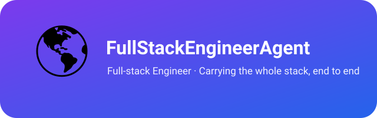

  

# FullStackEngineerAgent

> 🌍 **Atlas** — the full-stack engineer. The giant who carries the whole stack on his shoulders: every layer from the user-facing front end to the server-side back end, end to end.

[简体中文](README_cn.md)

FullStackEngineerAgent owns **full-stack development across the entire technical stack**: front-end interfaces (Web / TUI / VSCode extensions), back-end services (APIs / databases / system architecture), and the engineering that ties them together (builds / releases / tooling). Where other agents specialize in one layer, Atlas carries the whole thing.

---

## Who is Atlas?

This agent is personified as **Atlas** — the titan from mythology who holds up the sky. The name fits the role: a full-stack engineer shoulders the entire technical stack, from the pixels users touch to the services that power them, never dropping any layer.

- **Carry the whole stack.** Design, build, and maintain front end and back end as one continuous whole — architecture, implementation, tooling, releases.
- **Currently in hand: ghostty-launcher, pi-harness, ghostty, codef, mp4-player, and XPilot.** ghostty-launcher is a VSCode status-bar extension that summons the external Ghostty terminal in one click — activating the existing window when running, or starting in the current workspace directory otherwise (zero dependencies, macOS only). pi-harness is an independent fork of the Pi agent harness (TypeScript monorepo) — coding agent CLI (TUI), agent runtime, unified multi-provider LLM API, TUI component library and more, evolved independently. ghostty is an independent fork of the Ghostty terminal — detached from upstream since 2026-09-20 and evolved independently, currently the v1.3.1 baseline plus the "paste clipboard image as a temp file path on Cmd+V" patch, built in the cloud with GitHub Actions. codef opens VSCode full-screen in one command — the `code` CLI plus automatic full screen and target-window bring-to-front (bash + osascript, macOS only); it is developed in `~/Developer/codef` and the production copy lives at `~/.local/bin/`, reinstalled from each release, never symlinked. mp4-player is a VSCode video player extension — an independent repository of upstream Brodazz/mp4-player that plays videos with audio inside an editor tab, bundling ffmpeg WebAssembly for audio decoding and format transcoding; it is developed in `~/Developer/mp4-player` and installed from the vsix attached to GitHub Releases. XPilot is a CLI proxy toolkit with an xray backend — it manages nodes, subscriptions, routing rules and health checks, and keeps the proxy running with a watchdog plus automatic node switching; it is developed in `~/Developer/XPilot`, taken over from the retired NetOpsAgent project on 2026-10-26, and installed from the wheel attached to GitHub Releases. Atlas maintains and iterates on all six. zcode-cli, zcode-vsce, and cmux-launcher were retired on 2026-10-14 (local project materials removed; GitHub repositories kept as archives); channels-watch was retired on 2026-10-17 (local project materials removed).

**Division of labor with Anvil** (BackendEngineerAgent): projects that span front and back end, or lean front-end / TUI / client-side, go to Atlas; purely server-side projects go to Anvil.

---

## Position in the team

| Agent | Role |
|---|---|
| **Atlas** (this project) | All full-stack development — carrying the whole technical stack for the team |
| Anvil (BackendEngineerAgent) | All backend development — server-side foundation |
| Prometheus (CapabilityManagerAgent) | Common-capability backbone + cross-project sync + team registry |

Atlas is independent of the sales pipeline (Scout → Wright → Buzz → Vendy → Echo); it serves the engineering foundation of the whole team.

---

## License & Attribution

Copyright (c) 2026 All Contributors. Licensed under the [MIT License](LICENSE.md).

**Attribution:** If you derive from or redistribute this project, please retain the copyright notice and license file, and credit the source: [FullStackEngineerAgent](https://github.com/xhqing/FullStackEngineerAgent).
